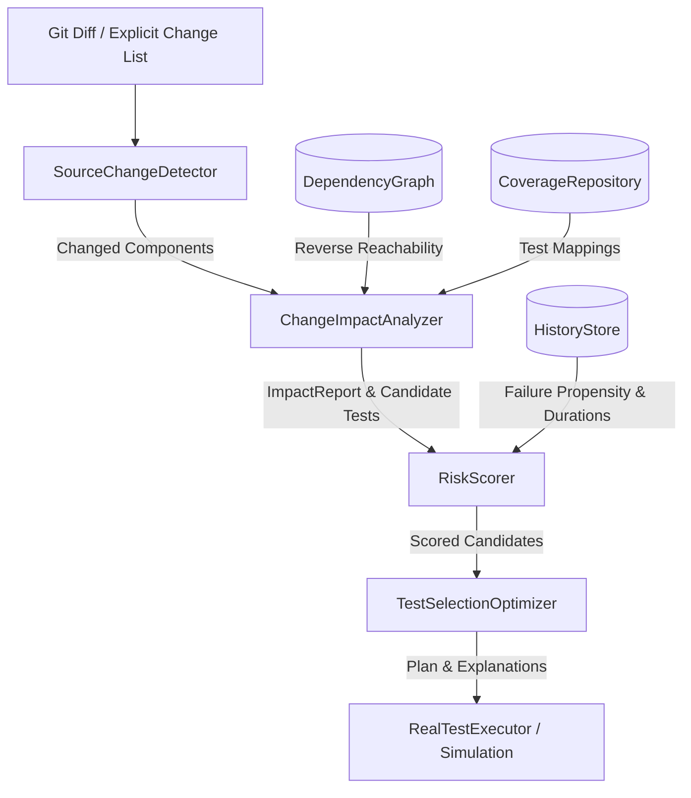

# ChangeImpact: Risk-Aware Incremental Regression Testing Engine

[]()
[]()
[]()
[]()

**ChangeImpact** is an incremental regression-testing engine designed to analyze code changes in a software system, compute affected components via cycle-safe reverse reachability dependency analysis, and prioritize tests under configurable execution-time budgets.

Rather than running full test suites or using static, one-time prioritization sorts that select redundant tests, ChangeImpact implements a **submodular greedy optimizer** that selects tests based on their **marginal risk-weighted coverage per execution cost**.

---

## Key Capabilities

- **Cycle-Safe Dependency Graph**: Custom directed graph implementation in standard Java collections (`Map`, `Set`, `List`) featuring Tarjan's Strongly Connected Components algorithm for cycle detection and safe traversal.
- **Git & Explicit Change Detection**: Automatic diff detection via Git porcelain status or explicit file lists, with resilient path-to-component mapping.
- **Normalized Risk Scoring**: Multi-objective feature vector incorporating topological proximity ($1/(1+d)$), Laplace-smoothed or recency-decayed failure history, change coverage breadth, and uncertainty exploration bonus for cold-start tests.
- **Submodular Marginal Coverage Deduplication**: Dynamically recalculates marginal coverage during selection, eliminating duplicate coverage credit and skipping redundant tests.
- **Hard Budget Enforcement**: Strict budget adherence guaranteeing that execution budgets are never exceeded.
- **Dual Execution Modes**: Real dynamic test execution via JUnit Platform Launcher (`org.junit.platform.launcher`) or deterministic simulation against ground-truth injected faults.
- **Systematic Multi-Strategy Benchmarking**: Automatically compares Full Suite, Dependency-Based, Greedy Cost-Only, Greedy Failure-Only, and Risk-Aware Budgeted strategies across 70 evaluation runs, exporting CSV metrics and Python matplotlib charts.
- **Explainable Decisions**: Produces machine-readable and human-verifiable justifications for every test (selected rank, marginal gain, efficiency, or skip reason).
- **Interactive Web Dashboard**: Embedded HTML5/CSS3/JS visualization interface for real-time scenario inspection, budget tuning, and trade-off exploration.

---

## Architecture Overview



Detailed architectural specifications and component contracts are documented in [docs/ARCHITECTURE.md](docs/ARCHITECTURE.md).

---

## Prerequisites

- **Java Development Kit**: Java 21 LTS or compatible JDK (`java -version`, `javac -version`).
- **Build System**: Apache Maven 3.8+ (`mvn -version`).
- **Python (Optional for Charts)**: Python 3.10+ with `pandas` and `matplotlib` (`pip install pandas matplotlib`).
- **Git**: Git 2.x for VCS diff detection.

---

## Quick Start & Build

Clone or navigate to the repository and build the executable shaded JAR:

```bash
# Compile and run all 27 unit & integration tests
mvn clean test

# Build shaded standalone JAR
mvn package -DskipTests
```

The executable fat JAR will be located at: `target/changeimpact-engine-1.0.0.jar`.

---

## Command-Line Interface (CLI) Reference

The engine provides an intuitive command-line interface powered by Picocli:

```bash
java -jar target/changeimpact-engine-1.0.0.jar --help
```

### 1. Analyze Change Impact
Analyze directly changed files, compute reverse-reachable affected components, and identify candidate tests:

```bash
java -jar target/changeimpact-engine-1.0.0.jar analyze --changed TaxCalculator
```

*Example Output:*
```text
=== ChangeImpact Analysis Report ===
Directly Changed Components: [TaxCalculator]
Potentially Affected Components (6):
  - TaxCalculator        (dist: 0, direct: true, path: TaxCalculator)
  - OrderService         (dist: 1, direct: false, path: TaxCalculator -> OrderService)
  - ShippingService      (dist: 2, direct: false, path: TaxCalculator -> OrderService -> ShippingService)
  - ReportService        (dist: 2, direct: false, path: TaxCalculator -> OrderService -> ReportService)
  - FraudDetector        (dist: 2, direct: false, path: TaxCalculator -> OrderService -> FraudDetector)
  - PaymentGateway       (dist: 3, direct: false, path: TaxCalculator -> OrderService -> FraudDetector -> PaymentGateway)

Candidate Tests Identified (8):
  * TestTaxUnit (covers: [TaxCalculator])
  * TestOrderUnit (covers: [TaxCalculator, OrderService])
  * TestShippingUnit (covers: [ShippingService])
  ...
[WARNING] Graph contains 1 dependency cycle(s). Cycle-safe traversal applied.
Analysis completed in 1 ms.
```

### 2. Select and Prioritize Tests under Time Budget
Select candidate tests using the risk-aware marginal optimizer under a strict execution budget:

```bash
java -jar target/changeimpact-engine-1.0.0.jar select --changed TaxCalculator --strategy risk-aware --budget 200ms --explain
```

*Example Output:*
```text
=== ChangeImpact Test Selection ===
Strategy: RISK_AWARE_BUDGETED | Budget: 200 ms | Used: 142 ms (3.2% of full suite)
Affected Components: [ShippingService, PaymentGateway, ReportService, OrderService, FraudDetector, TaxCalculator]
Selected Tests (5 of 8 candidates, 16 total suite):
  [1] TestTaxUnit                  Cost:   10ms | RiskScore: 0.4356 | CoversAffected: [TaxCalculator]
  [2] TestOrderUnit                Cost:   30ms | RiskScore: 0.4693 | CoversAffected: [OrderService, TaxCalculator]
  [3] TestShippingUnit             Cost:   28ms | RiskScore: 0.1910 | CoversAffected: [ShippingService]
  [4] TestFraudUnit                Cost:   35ms | RiskScore: 0.1789 | CoversAffected: [FraudDetector]
  [5] TestPaymentUnit              Cost:   39ms | RiskScore: 0.1857 | CoversAffected: [PaymentGateway]

Affected Components Coverage: 83.3% (5 of 6)

=== Detailed Selection Explanations ===
[SELECTED] TestTaxUnit (order=1, cost=10ms, marginalGain=0.4356): Selected (efficiency=0.043556, newlyCovered=1, remainingBudget=190ms)
[SELECTED] TestOrderUnit (order=2, cost=30ms, marginalGain=0.2347): Selected (efficiency=0.007822, newlyCovered=1, remainingBudget=160ms)
[SKIPPED_REDUNDANT] TestEndToEndCheckout (order=-1, cost=1818ms): All affected components covered by this test are already covered by previously selected tests.
[SKIPPED_REDUNDANT] TestIntegrationFraudCycle (order=-1, cost=387ms): All affected components covered by this test are already covered by previously selected tests.
```

### 3. Execute Selected Tests (Real or Simulated)
Run selected tests either genuinely via JUnit Platform Launcher or deterministically simulated:

```bash
# Simulated execution mode
java -jar target/changeimpact-engine-1.0.0.jar run --changed TaxCalculator --strategy risk-aware --budget 200ms --simulate

# Real JUnit Platform execution mode
java -cp "target/changeimpact-engine-1.0.0.jar;target/test-classes" com.changeimpact.cli.ChangeImpactCli run --changed AccountService --strategy risk-aware --budget 2000ms
```

### 4. Run Reproducible Benchmark Suite
Execute the 70-configuration benchmark matrix comparing all strategies across budgets:

```bash
java -jar target/changeimpact-engine-1.0.0.jar benchmark --visualize
```

Outputs:
- Machine-readable CSV: `benchmarks/results/benchmark_results.csv`
- Markdown summary report: `benchmarks/results/benchmark_report.md`
- Visual publication-quality charts: `benchmarks/results/charts/*.png`

### 5. Inspect Dependency Graph & Cycles
```bash
java -jar target/changeimpact-engine-1.0.0.jar graph --cycles
```

### 6. Inspect Test History Store
```bash
# View sample historical records
java -jar target/changeimpact-engine-1.0.0.jar history

# Query specific test statistics
java -jar target/changeimpact-engine-1.0.0.jar history --test TestPaymentUnit
```

### 7. Launch Interactive Web Dashboard
```bash
# View dashboard HTML file path
java -jar target/changeimpact-engine-1.0.0.jar dashboard --file-only

# Or launch localhost server on port 8080
java -jar target/changeimpact-engine-1.0.0.jar dashboard --port 8080
```
Open `dashboard/index.html` in your web browser to explore interactive scenarios, budget sliders, and charts.

---

## Empirical Benchmark Findings Summary

From our 70 systematic benchmark evaluations on the synthetic banking pipeline:

1. **Massive Runtime Reductions**:
   - On leaf modifications (`SCN_01`), `RISK_AWARE_BUDGETED` completes in **142 ms** compared to **4,405 ms** for `FULL_SUITE` (**96.8% runtime reduction**) while maintaining **100% fault detection** and **83.3% affected component coverage**.
2. **Submodular Deduplication Value**:
   - Skips heavy end-to-end tests (e.g. `TestEndToEndCheckout`, 1800ms) when unit tests already cover the affected components.
3. **Important Trade-off & Defect Blind Spot**:
   - In Scenario 2, an inter-service contract bug between `PaymentGateway` and `FraudDetector` was missed (50% fault detection) because individual unit tests covered both components, causing the deduplicator to classify the integration test as redundant.
   - For an honest, detailed analysis, see [docs/TECHNICAL_AUDIT.md](docs/TECHNICAL_AUDIT.md) and [docs/EVALUATION.md](docs/EVALUATION.md).

---

## Technical Documentation Index

- [docs/ARCHITECTURE.md](docs/ARCHITECTURE.md): Component responsibilities, pipeline data flow, and cache architecture.
- [docs/ALGORITHM.md](docs/ALGORITHM.md): Formal equations, submodular pseudocode, complexity analysis, and hand-calculated verification.
- [docs/EVALUATION.md](docs/EVALUATION.md): Experimental design, baselines, full metrics table, and trade-off analysis.
- [docs/LIMITATIONS.md](docs/LIMITATIONS.md): Limitations of static dependency graphs, coarse component granularity, and future roadmap.
- [docs/TECHNICAL_AUDIT.md](docs/TECHNICAL_AUDIT.md): Senior software engineer technical audit addressing what works, what is simulated, strengths, and failure modes.

---

## License

This project is released under the MIT Open Source License.
