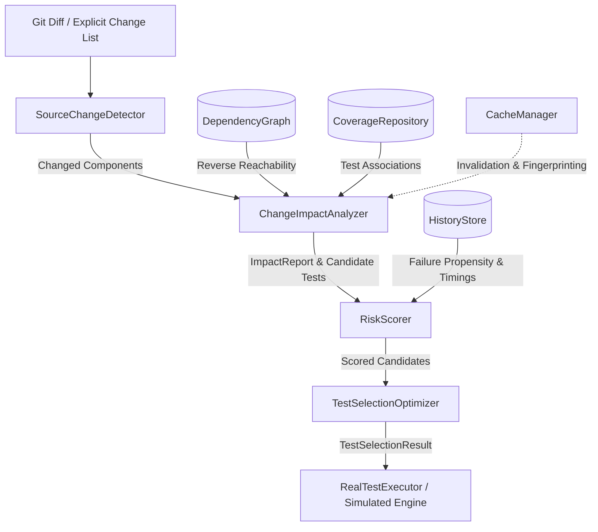

# ChangeImpact: System Architecture & Design

ChangeImpact is an incremental, risk-aware regression testing engine designed to analyze software changes, identify affected components via dependency reachability, prioritize candidate tests, and enforce hard execution-time budgets.

## 1. High-Level Component Responsibilities

### Component Details

| Component | Responsibility | Inputs | Outputs |
| :--- | :--- | :--- | :--- |
| `SourceChangeDetector` | Identifies changed files via Git porcelain diffs or explicit lists; normalizes paths and maps files to graph component IDs. | Git working tree, commit ref, or explicit string paths | Set of changed component IDs |
| `DependencyGraph` | Represents modules, components, functions, and tests as directed nodes. Computes reverse reachability and detects strongly connected cycles. | Graph nodes, directed dependency edges | Forward/reverse neighbors, reverse reachability paths, cycle reports |
| `CoverageRepository` | Tracks which tests exercise which software components. Distinguishes measured runtime coverage from synthetic benchmark coverage. | Test IDs, component IDs, coverage source enum | Test-to-component and component-to-test indexes |
| `ChangeImpactAnalyzer` | Performs cycle-safe reverse reachability from changed components to determine all affected production components and queries tests that exercise them. | Changed component IDs, `DependencyGraph`, `CoverageRepository` | `ImpactReport` with affected components, depths, paths, candidate tests, and warnings |
| `RiskScorer` | Evaluates multi-dimensional features for each candidate test and computes a normalized risk score ($[0.0, 1.0]$). Handles cold-start missing history via uninformative priors. | Candidate tests, impacted components, `HistoryStore`, `RiskWeights` | List of scored `TestCandidate` entities sorted deterministically |
| `TestSelectionOptimizer` | Implements baseline strategies and a submodular greedy heuristic that chooses tests by marginal risk-weighted coverage per cost, deduplicating component coverage. | Scored candidates, full suite candidates, time budget, weights | `TestSelectionResult` with selected tests, explanations, and budget usage |
| `HistoryStore` | Persists previous test outcomes (pass/fail), run durations, and timestamps. Calculates Laplace-smoothed and exponential recency-weighted failure signals. | Run outcomes, durations | Failure signals, mean durations, total run counts |
| `RealTestExecutor` | Dynamically executes tests using JUnit Platform Launcher (`org.junit.platform.launcher`), timing actual execution in milliseconds. | Selected test candidates, `HistoryStore` | Real execution report (wall-clock duration, pass/fail status) |
| `CacheManager` | Caches impact reports and test selection decisions based on cryptographic SHA-256 fingerprints of inputs, graph structure, and configuration. | Changed components, graph fingerprint, config hash | Cached `ImpactReport` or cache miss |
| `EvaluationEngine` | Coordinates systematic multi-strategy benchmarking across scenarios and budget levels, exporting CSV metrics and Markdown reports. | `BenchmarkSuite` | CSV dataset, Markdown evaluation summaries |

---

## 2. Data Flow & Execution Pipeline

1. **Change Ingestion**: `SourceChangeDetector` reads modified files from `git status --porcelain` or an explicit file list. File paths are resolved against the `DependencyGraph` component directory.
2. **Impact Propagation**: `ChangeImpactAnalyzer` executes a breadth-first search along **reverse dependency edges** starting from the changed components. If component $B$ depends on component $A$ ($B \to A$), modifying $A$ impacts $B$. Cycle detection (Tarjan's algorithm) ensures that cyclic references ($A \to B \to C \to A$) do not trigger infinite loops.
3. **Candidate Identification**: The analyzer queries `CoverageRepository` for all tests that exercise any affected component.
4. **Risk Scoring**: For each candidate test $t$, `RiskScorer` evaluates:
   - Proximity to root change (Impact Relevance)
   - Historical failure frequency (Failure Signal)
   - Coverage breadth across affected components (Change Coverage)
   - Historical sample size (Uncertainty Adjustment)
5. **Budget-Constrained Selection**: `TestSelectionOptimizer` iteratively selects tests that maximize marginal coverage per unit execution cost while strictly enforcing the hard time budget constraint.
6. **Execution / Simulation**: Tests are either genuinely executed through `RealTestExecutor` via the JUnit 5 platform launcher or evaluated against synthetic benchmark fault ground truth.

---

## 3. Separation of Selection from Execution

ChangeImpact deliberately decouples test selection from test execution:
- Selection produces an explainable, inspectable plan (`TestSelectionResult`) containing selection status, marginal gains, and cost estimates.
- The plan can be audited, logged, or dry-run in CI pipelines before deciding whether to invoke the test runner.
- Execution (`RealTestExecutor`) accepts selected candidates and executes them without dependency on the scoring algorithm.

---

## 4. Cache Invalidation Architecture

The `CacheManager` computes a composite cache key:
$$\text{Key} = \text{SHA-256}\Big(\text{SortedChangedComponents} \parallel \text{GraphFingerprint} \parallel \text{ConfigFingerprint}\Big)$$

- **Graph Fingerprint**: Generated from node count, edge count, and node IDs. If any component is added, removed, or has its dependencies altered, the fingerprint changes.
- **Config Fingerprint**: Changes if risk weights ($w_1, w_2, w_3, w_4$), recency decay, or budget thresholds are updated.
- **Stale Entry Eviction**: Any cache miss triggers a fresh analysis and replaces the outdated cache entry on disk.
